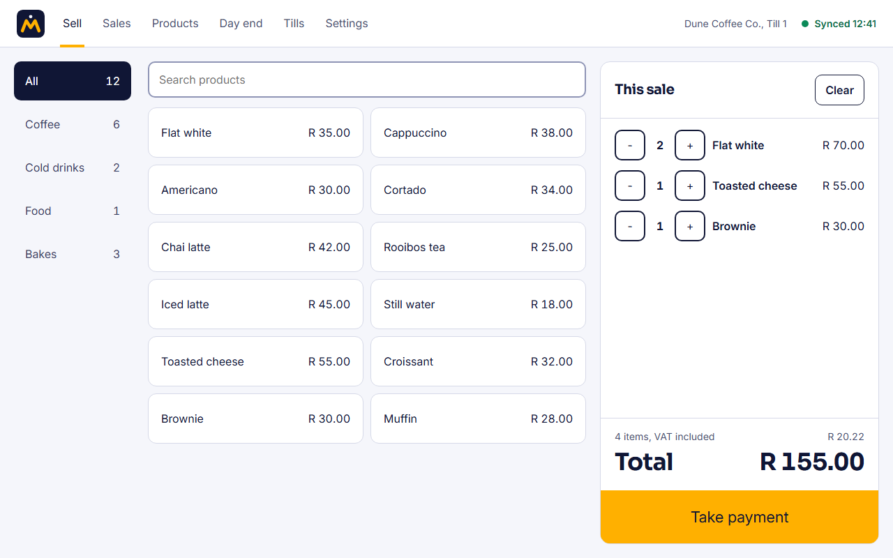
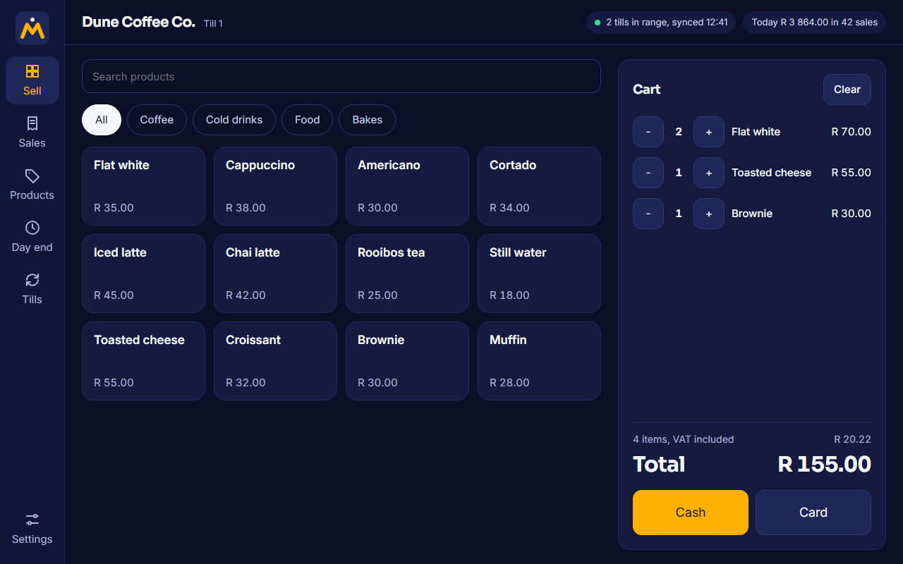
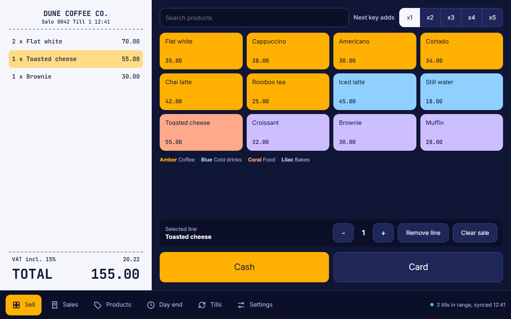

<p align="center">
  
</p>

<p align="center">
  <a href="https://github.com/rizonesoft/Merchant/actions/workflows/ci.yml"></a>
  
  
  
  
  <a href="LICENSE"></a>
</p>

<p align="center">
  <a href="#what-is-merchant">What it is</a> ·
  <a href="#what-will-it-look-like">Three looks</a> ·
  <a href="#how-does-it-work-without-the-internet">How it works</a> ·
  <a href="#how-do-i-run-it">Run it</a> ·
  <a href="#where-is-the-project-now">Status</a> ·
  <a href="CONTRIBUTING.md">Contributing</a>
</p>

## What is Merchant?

Merchant is a point of sale for pop-up shops and food trucks that needs no cloud. It works fully offline, keeps every sale in an encrypted file on the till, and syncs with the shop's other tills over local Wi-Fi when they are in range.

- **No internet, no account.** A till sells with nothing but power. There is no sign-up and no server to pay for.
- **Sales are never lost.** Each sale is written to disk before the receipt prints. A sale is a permanent record: a refund adds a record, it never deletes one.
- **Tills find each other.** Two tills on the same Wi-Fi swap sales every 15 seconds, with no router setup and no internet.
- **Your data stays yours.** The database is encrypted on the till. A backup is one file locked with a passphrase you choose.

## What will it look like?

Merchant has three looks over the same till, chosen in Settings. Daylight is the default. These are the design references the interface is being built to match, screen for screen.

<p align="center">
  
  
  
</p>

- **Daylight** (left): light and high contrast, for direct sun.
- **Counter** (middle): dark, with product tiles and a cart.
- **Tape** (right): a paper receipt beside colour-coded keys.

Every screen in every look is in [`design/interface`](design/interface), and what each control does is written down in the [interface contract](design/SPEC.md).

## How does it work without the internet?

Everything the shop does is recorded as a fact that never changes: a product defined, a sale completed. Each fact has an id and a running number from the till that recorded it. What the till shows (the price list, today's takings) is worked out from those facts.

Syncing is then simple: two tills compare which facts each has, and each sends the other what it lacks. Because facts are never edited, there is nothing to conflict.

- **Pairing.** Tills of one shop share a pairing code. A till proves it holds the code without ever sending it, and the other side pins its certificate for the session. A till without the code gets nothing.
- **Discovery.** Tills announce themselves on the local network (mDNS), so there are no addresses to type.
- **Storage.** One SQLite file per till, encrypted, in write-ahead mode with full sync, so an acknowledged sale survives a power cut.
- **Receipts.** ESC/POS over the network to a standard receipt printer, which also opens the cash drawer.

A sync server for shops that want one always-on copy is planned as a separate project. Any server that speaks the three sync endpoints in [`src/Merchant.SyncHost`](src/Merchant.SyncHost) is found by tills like another till.

## How do I run it?

You need the [.NET 10 SDK](https://dotnet.microsoft.com/download).

```
git clone https://github.com/rizonesoft/Merchant.git
cd Merchant
dotnet run --project src/Merchant.Till
```

The till keeps its data in `%LOCALAPPDATA%\Merchant` on Windows and `~/.local/share/Merchant` on Linux. Set `MERCHANT_DATA_DIR` to use another folder, for example to run a second till on the same machine. Windows asks once to let the till through the firewall; other tills cannot reach it until that is allowed.

Run the tests with `dotnet test Merchant.slnx`.

## Where is the project now?

Merchant is in active development and is not ready to run a shop yet.

- **Working today:** the encrypted event store, sync between tills with pairing, discovery, receipt printing, backup and restore, and a first plain window that sells for cash or card. 19 tests cover them on Windows and Linux.
- **Being built:** the full interface in three looks, with products and categories, stock, refunds, day end with a cash count, till names and settings. The work is planned section by section in [`todo/implementation-plan.md`](todo/implementation-plan.md).
- **Not planned yet:** card reader integration, Bluetooth and USB printers, barcode scanning, discounts, and phone-sized screens.

## What is in this repository?

| Path | What it holds |
| --- | --- |
| `src/Merchant.Core` | Event store, shop state, sync protocol and client, discovery, receipts, backup |
| `src/Merchant.SyncHost` | The listening side of sync that each till runs |
| `src/Merchant.Till` | The till: an Avalonia desktop app |
| `tests/Merchant.Tests` | xUnit tests |
| `design/SPEC.md` | The interface contract: every control, state and rule |
| `design/interface` | The 27 design pages and their reference renders |
| `assets/brand`, `assets/fonts` | The mark, banners and icons, and the three typefaces |
| `todo` | The implementation plan, as small sections with checkable steps |
| `scripts` | Brand and design builders, and the planning and review tools |

The mark, banners and icons are built from one script: `python scripts/build-brand.py`. The design references are rendered with `python scripts/render-design.py`.

## How is the work planned and run?

Work is planned in [`todo`](todo) and built one section at a time, each reviewed by a different model family before it is marked done. The process is described in [`docs/todo-workflow.md`](docs/todo-workflow.md) and [`AGENTS.md`](AGENTS.md). Long runs with nobody at the keyboard are started from WSL as described in [`docs/unattended-run.md`](docs/unattended-run.md).

## Licence

Merchant is free software under the [GNU Affero General Public License v3.0](LICENSE). If you run a changed version for others to use, you must offer them its source.

Sora, Inter and JetBrains Mono are included under the SIL Open Font License; their licence texts are in [`assets/fonts`](assets/fonts).
